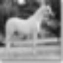
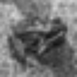
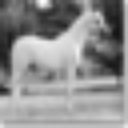
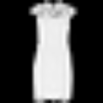
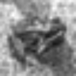
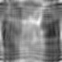
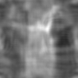
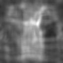
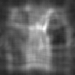
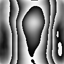

# Neural holography

Модель получает четыре grayscale-изображения 128x128 и за один проход строит одну фазовую маску того же размера. После переноса Френеля маска восстанавливает изображения на расстояниях 24.1, 25.3, 26.5 и 27.7 мм

Готовые веса находятся в `models/solution.pt`. Для инференса не нужны датасеты, GPU или подключение к сети

## Пример работы

### Входные изображения

| 24.1 мм | 25.3 мм | 26.5 мм | 27.7 мм |
| --- | --- | --- | --- |
|  |  |  |  |

### Нормированные цели

| 24.1 мм | 25.3 мм | 26.5 мм | 27.7 мм |
| --- | --- | --- | --- |
|  |  |  |  |

### Реконструкции

| 24.1 мм | 25.3 мм | 26.5 мм | 27.7 мм |
| --- | --- | --- | --- |
|  |  |  |  |

### Фазовая маска



## Архитектура R72

Финальная модель R72 использует архитектуру `transport_spatial_complex` с 205188 обучаемыми параметрами

- Target U-Net кодирует четыре нормированных изображения и предсказывает фазы целевых полей
- Амплитуды и обучаемые фазы образуют комплексные признаки для каждой плоскости
- Сопряжённый перенос Френеля переводит признаки из четырёх плоскостей в координаты ДОЭ
- Complex Decoder смешивает признаки комплексными свёртками 3x3 и gates по модулю
- Circular head выдаёт две компоненты поля, а `atan2` преобразует их в фазу от $\pi$ до $\pi$
- Фаза квантуется в 8-битный PNG, после чего маска повторно читается и используется для восстановления

## Физика и сохранённые PNG

Используется равномерное единичное освещение, длина волны 532 нм, шаг пиксела ДОЭ 10 мкм и маска 128x128. Для каждой глубины поле вычисляется single-FFT переносом Френеля

$$
U_z(x,y)=\frac{e^{ikz}}{i\lambda z}e^{i\pi(x^2+y^2)/(\lambda z)}
\mathcal F\left[e^{i\phi(u,v)}e^{i\pi(u^2+v^2)/(\lambda z)}\right],
\qquad k=\frac{2\pi}{\lambda}
$$

Реконструкция определяется как нормированный модуль поля $|U_z|$, а не его интенсивность. Центрированная сетка использует индексы от -64 до 63. Шаг выходной плоскости зависит от расстояния по формуле $\Delta x_z=\lambda z/(N\Delta u)$

| Плоскость | Расстояние | Шаг выходной плоскости |
| --- | ---: | ---: |
| 1 | 24.1 мм | 10.0166 мкм |
| 2 | 25.3 мм | 10.5153 мкм |
| 3 | 26.5 мм | 11.0141 мкм |
| 4 | 27.7 мм | 11.5128 мкм |

Фаза сохраняется в `phase.png` как 8-битное значение $q=\mathrm{round}(255(\phi+\pi)/(2\pi))$. Перед восстановлением файл читается обратно по формуле $\phi=2\pi q/255-\pi$, поэтому инференс и метрики учитывают квантование итоговой маски

При инференсе сеть сразу выдаёт фазовую маску. Итеративной оптимизации маски, GS/Фиенапа и фазовых меток нет

## Как выбирали решение

В первых запусках проверялись обычные CNN и автоэнкодеры, Fourier-блоки, attention, разные способы кодирования фазы и прямой U-Net. Эти варианты помогли проверить базовый pipeline, но плохо разделяли изображения между глубинами

Следующий этап использовал обучаемые комплексные признаки и сопряжённый перенос в плоскость ДОЭ. Отдельно проверялись pointwise и spatial Complex Decoder, разные функции потерь и продолжение обучения с сохранением выбранных весов

Рост SSIM не принимался автоматически. Например, один из запусков получил высокий SSIM за счёт ярких пиков и тёмных восстановлений при слабом Pearson. После этого в оценку добавили проверки Pearson, яркости foreground и концентрации энергии

Финальная цепочка состояла из R46, R54, R62 и R72. В R54 появился пространственный Complex Decoder, R62 получил более длинное обучение, а R72 проверил меньший learning rate без изменения архитектуры. R72 выбрали по SSIM на отдельном reserve-наборе при прохождении дополнительных проверок. Один checkpoint был зафиксирован до открытия test split, после чего веса и гиперпараметры не менялись

## Результаты

Итоговая модель проверена на публичных test split CIFAR10, MNIST и FashionMNIST

| Набор | Четвёрок | SSIM | Pearson |
| --- | ---: | ---: | ---: |
| Selection validation | 256 | 0.3388 | 0.5527 |
| Reserve | 512 | 0.3361 | 0.5537 |
| Public test | 1024 | 0.3380 | 0.5620 |

| Состав Public test, по 256 четвёрок | SSIM | Pearson |
| --- | ---: | ---: |
| CIFAR10 | 0.469652 | 0.375518 |
| MNIST | 0.343168 | 0.670106 |
| FashionMNIST | 0.261809 | 0.678795 |
| mixed | 0.277382 | 0.523767 |

### Скорость

| CPU, batch 1, четыре потока | Время |
| --- | ---: |
| Один forward сети, медиана после прогрева | 20.12 мс |
| Нормировка -> сеть -> маска -> Френель -> uint8, медиана после прогрева | 21.64 мс |
| Отдельный CLI-процесс с загрузкой весов, PNG I/O и метриками | 1.872 с |

Публичный test содержит 1024 четвёрки и 4096 восстановленных плоскостей. Метрики усредняются равномерно по плоскостям и четвёркам

Оценка выполняется после сохранения и повторного чтения `phase.png` и PNG-реконструкций. Каждая целевая амплитуда и каждое восстановление нормируются по собственному максимуму. Такой протокол учитывает фактическое 8-битное квантование выдаваемой маски

## Данные

Для обучения использовались [CIFAR10](https://www.cs.toronto.edu/~kriz/cifar.html), [MNIST](https://ossci-datasets.s3.amazonaws.com/mnist/) и [FashionMNIST](https://github.com/zalandoresearch/fashion-mnist/tree/master/data/fashion). Скрипт загрузки получает исходные train/test-файлы и проверяет архивы по контрольным суммам

```bash
python scripts/download_data.py --root data
python scripts/download_data.py --root data --verify-only
```

CIFAR10 переводится из RGB в grayscale по стандартным коэффициентам яркости. MNIST и FashionMNIST читаются из исходного IDX. Все изображения масштабируются до 128x128 билинейной интерполяцией и переводятся в диапазон от 0 до 1

Для train/validation используется стратифицированное разделение 90/10 с seed 42. Разделение выполняется по исходным изображениям до сборки четвёрок. В обучении используются как однородные комплекты из одного датасета, так и смешанные комплекты

## Запуск готового решения

Нужны четыре PNG 128x128, grayscale, 8 бит. Порядок входов соответствует расстояниям 24.1, 25.3, 26.5 и 27.7 мм. Датасеты и GPU для инференса не нужны

### Docker

Сборка CPU-образа:

```bash
docker build --platform linux/amd64 -t neural-holography:solution .
```

Запуск на первом включённом комплекте в Linux или Git Bash:

```bash
mkdir -p results
docker run --rm --network none \
  --mount "type=bind,source=$(pwd)/examples,target=/input,readonly" \
  --mount "type=bind,source=$(pwd)/results,target=/output" \
  neural-holography:solution \
  --inputs /input/image1.png /input/image2.png /input/image3.png /input/image4.png \
  --output /output/demo
```

PowerShell:

```powershell
New-Item -ItemType Directory -Force results | Out-Null
docker run --rm --network none --mount "type=bind,source=$((Get-Location).Path)/examples,target=/input,readonly" --mount "type=bind,source=$((Get-Location).Path)/results,target=/output" neural-holography:solution --inputs /input/image1.png /input/image2.png /input/image3.png /input/image4.png --output /output/demo
```

Каталог результата должен отсутствовать до запуска, чтобы программа не перезаписала существующие файлы

Контейнер работает с `--network none`. Интернет нужен только один раз при сборке образа для установки зависимостей

### Python без Docker

Для CPU-инференса используется Python 3.11 и отдельное окружение

```bash
python3.11 -m venv .venv-runtime
.venv-runtime/bin/python -m pip install -r requirements-runtime.txt
.venv-runtime/bin/python -m src.predict \
  --checkpoint models/solution.pt \
  --device cpu \
  --inputs examples/image1.png examples/image2.png examples/image3.png examples/image4.png \
  --output results/python_demo
```

В Windows вместо `.venv-runtime/bin/python` используется `.venv-runtime\Scripts\python.exe`

Каждый запуск создаёт:

```text
results/demo/
  phase.png
  reconstruction_1.png
  reconstruction_2.png
  reconstruction_3.png
  reconstruction_4.png
  target_1.png ... target_4.png
  metrics.json
```

`phase.png` содержит фазу, четыре `reconstruction_*.png` - восстановленные амплитуды, `target_*.png` - точные копии входных файлов. В `metrics.json` записаны SSIM, Pearson, параметры протокола и контрольная сумма checkpoint

## Ограничения

- Модель работает только с четырьмя изображениями 128x128 и фиксированными параметрами оптической схемы
- Между плоскостями остаются заметные помехи, особенно на простых контрастных объектах
- Качество зависит от типа входных изображений, а средние метрики не гарантируют хорошую реконструкцию каждого отдельного комплекта
- Результаты получены на публичных датасетах
- Выбранная ветка обучена с одним seed, устойчивость результата к другим seed не проверялась
